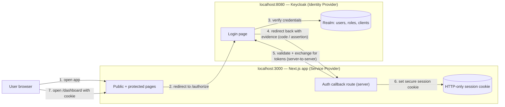

# SSO Lab

A standalone learning project for **enterprise Single Sign-On (SSO)**: a
Next.js application (the future *Service Provider*) that authenticates
against a local **Keycloak** Identity Provider (IdP) running in Docker.

Everything here is intentionally isolated from any other application, so you
can freely experiment, break things, and reset them.

## Stack

| Component            | Technology                                      | Version (pinned/verified) |
| -------------------- | ----------------------------------------------- | ------------------------- |
| Frontend + Backend   | Next.js (App Router, Route Handlers), TypeScript | Next 16.4.2               |
| Language             | TypeScript                                       | 5.x                       |
| Protocol (main flow) | OpenID Connect (OIDC) over OAuth 2.0             | Protocol is a standard    |
| Protocol (phase 5)   | SAML 2.0                                         | Protocol is a standard    |
| Identity Provider    | Keycloak in Docker                               | 26.8.1                    |
| Package manager      | npm                                              | 11.x                      |
| OS                   | Windows (PowerShell, VS Code)                    | -                         |

## Architecture (target)



During OIDC flows the browser performs the redirects (steps 1–4, 7); step 5
is a direct server-to-server HTTPS call from Next.js to Keycloak. Tokens never
travel through the page itself, and the session is an HTTP-only cookie —
never `localStorage`.

## Quick start

```powershell
# 1. Start the Identity Provider (from this folder)
docker compose up -d

# 2. Start the application
npm install
npm run dev
```

| Service                          | URL                         | First-time login      |
| -------------------------------- | --------------------------- | --------------------- |
| Keycloak admin console           | http://localhost:8080/admin | admin / admin         |
| Keycloak health check (optional) | http://localhost:19000/health | - (returns JSON)    |
> **About the `admin` account:** since Keycloak 26, the bootstrap admin is a
> *temporary* admin by design. The console shows a warning banner asking you
> to create a permanent admin. Fine for this lab; see Phase 1 checkpoint.

> **Port note for this machine:** your other projects (zyratalk, socialflux)
> already occupy `3000`, `9000`, `5432`, and `6379`. The lab therefore uses
> `3100` for the Next.js app and maps Keycloak's management port to `19000`.
> Keycloak itself (8080) was free and stays standard.

## Roadmap

- [x] **Phase 1** — Environment + local Keycloak via Docker Compose
- [x] **Phase 2** — Keycloak realm, test user, client registration
- [x] **Phase 3** — OIDC login with authorization code flow + PKCE, session, logout
- [ ] **Phase 4** — Full sequence-level walkthrough of the login flow
- [ ] **Phase 5** — SAML 2.0 login (separate implementation)
- [ ] **Phase 6** — Role-based authorization + security hardening
- [ ] **Phase 7** — Troubleshooting guide

## Phase 1 operations cheat sheet

```powershell
docker compose ps                     # is Keycloak running?
docker compose logs -f keycloak       # live Keycloak logs (Ctrl+C to stop tailing)
docker compose down                   # stop Keycloak (realm data survives)
docker compose down -v                # stop AND delete realm data (full reset)
```

## Troubleshooting (Phase 1 issues)

| Symptom                            | Likely cause                          | Fix                                                                 |
| ---------------------------------- | ------------------------------------- | -------------------------------------------------------------------- |
| `docker compose` says daemon down  | Docker Desktop not started            | Start Docker Desktop, wait for "Engine running"                       |
| Bind for 0.0.0.0:PORT failed       | Another app/container holds the port  | `Get-NetTCPConnection -LocalPort PORT -State Listen` to find the PID  |
| Container restarts endlessly       | Corrupt old H2 data volume            | `docker compose down -v`, then `docker compose up -d`                 |
| http://localhost:8080 unreachable  | Container still starting              | Wait ~20-40 s, then check `docker compose logs keycloak`              |
| "5 high severity vulnerabilities" from npm | Scaffold-only dev-tool findings | Not relevant yet; we audit again when runtime deps enter in Phase 3 |

## Troubleshooting (Phase 3 issues)

| Symptom | Likely cause | Fix |
| ------- | ------------ | --- |
| Keycloak "Invalid redirect uri" after clicking Sign out | `post_logout_redirect_uri` is compared byte-for-byte against the client's "Valid post logout redirect URIs"; `http://localhost:3100/` (trailing slash) does NOT match registered `http://localhost:3100` | Keep the app's value identical to the registered one - our logout route sends `origin` without a trailing slash (app/auth/logout/route.ts) |
| Dashboard renders "No active session" although login succeeded | Dev mode compiles each route as its own bundle: two copies of lib/session.ts's in-memory Map | Keep module-level state on `globalThis` (lib/session.ts) - same trick as the Next.js docs use for DB clients |
| Dev overlay: "encountered the unstable value Date.now() while prerendering" | Cache Components: TTL logic touches the wall clock during prerender | `await io()` at the top of the Suspense-wrapped component (app/dashboard/dashboard-content.tsx); `connection()` no longer exists in this Next version |
| "only requests to HTTPS are allowed" at login | openid-client refuses plain HTTP per OpenID security spec | Dev-only: pass `allowInsecureRequests` to discovery when NODE_ENV !== production (lib/oidc.ts); production stays HTTPS-strict |

## Official documentation used

- Keycloak container guide: https://www.keycloak.org/guides
- Keycloak server admin guide: https://www.keycloak.org/documentation
- Next.js App Router docs: https://nextjs.org/docs/getting-started
- OIDC specification: https://openid.net/specs/openid-connect-core-1_0.html
- SAML 2.0 core: https://docs.oasis-open.org/security/saml/v2.0/saml-core-2.0-os.html
- Deep dive into what was built and how every flow works: [docs/HOW-IT-WORKS.md](docs/HOW-IT-WORKS.md)
