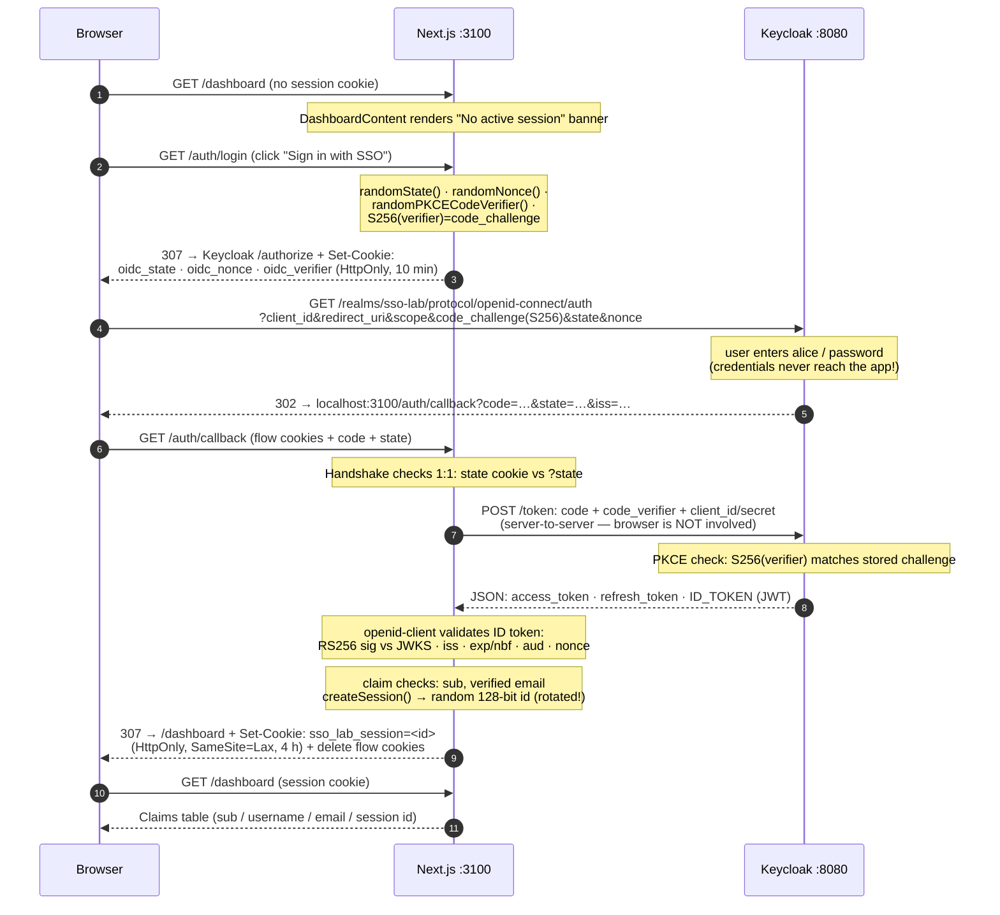
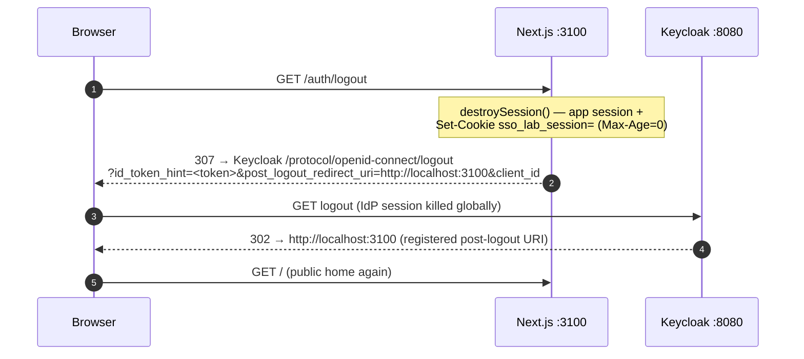

# SSO Lab — What We Built & How It Works

Companion to the `README.md` (setup, ports, troubleshooting). This document 
explains **what exists in the repo today** (Phases 1–3 complete) and **how 
each piece actually works**, so you can re-read the flow any time.

---

## 1. What we built

| Phase | Delivered | Status |
| ----- | --------- | ------ |
| **1** | Local Keycloak 26.8.1 via Docker Compose (`sso-lab` project), Next.js app scaffold | done |
| **2** | Keycloak realm `sso-lab`, test user `alice`, confidential client `sso-lab-nextjs` with PKCE S256 | done |
| **3** | Full OIDC **login** (Authorization Code + PKCE), **own session layer**, and **logout** (single sign-out) — hand-rolled with `openid-client`, not a framework auth package | done |
| 4–7 | Sequence walkthrough, SAML, roles, guide | planned |

The core learning idea: **no NextAuth/Auth.js** — we implement every protocol 
step ourselves so each HTTP hop is visible and understandable. Only the 
token plumbing/JOSE crypto is delegated to the battle-tested `openid-client` 
library (v6.8.8).

---

## 2. The cast (roles)

| Actor | Who plays it | Address |
| ----- | ------------ | ------- |
| **User Agent** | Your browser (curl in tests) | — |
| **OpenID Relying Party (client / SP)** | Our Next.js app | `http://localhost:3100` |
| **Identity Provider / Authorization Server** | Keycloak, realm `sso-lab` | `http://localhost:8080` |

---

## 3. Repository map

```
sso-lab/
├── docker-compose.yml            # Keycloak container + health + named volume
├── .env                          # server-only: issuer, realm, client id, CLIENT SECRET
├── .env.example                  # template (committed)
├── README.md                     # setup, ports, cheat sheet, troubleshooting tables
├── docs/HOW-IT-WORKS.md          # ← you are here
├── lib/
│   ├── oidc.ts                   # discovery of Keycloak's OIDC metadata (cached, promise)
│   └── session.ts                # app session store (globalThis Map), TTL, cookie names
└── app/
    ├── page.tsx                  # public home: phase status + links
    ├── globals.css               # container/btn/banner/kv styles
    ├── login/
    │   ├── page.tsx              # public sign-in landing
    │   └── login-form.tsx        # button -> /auth/login; shows ?error=1 badge
    ├── dashboard/
    │   ├── page.tsx              # PROTECTED page shell + <Suspense>
    │   └── dashboard-content.tsx # async: io() => getServerSession() => claims table
    └── auth/                     # Route Handlers = the protocol machinery
        ├── login/route.ts        # GET: mint state/nonce/PKCE, 307 -> Keycloak
        ├── callback/route.ts     # GET: validate + exchange code, create session
        └── logout/route.ts       # GET: kill app session, 307 -> Keycloak end-session
```

Everything under `app/auth/*` is a **Route Handler** (server-only) — the
browser only sees cookies and redirects, never tokens.

---

## 4. Keycloak side (what Phase 2 created)

Verified live on the running container via `kcadm.sh`:

| Item | Value |
| ---- | ----- |
| Realm | `sso-lab` |
| Realm user | `alice` (`alice@example.com`, email verified, password set in admin UI) |
| Admin bootstrap | `admin`/`admin` — *temporary* admin (Keycloak 26 behavior, console warns) |
| Client | `sso-lab-nextjs`, **confidential** (`publicClient: false`) |
| Client auth | `standard token exchange` off, Direct Access Grants off (no password-API login by the app!) |
| Valid redirect URIs | `http://localhost:3100/auth/callback` |
| Valid post-logout redirect URIs | `http://localhost:3100` (exact string!) |
| Web origin | `http://localhost:3100` |
| Require PKCE | S256 (`pkce.code.challenge.method`) |
| Logout confirmation | skipped (`logout.confirmation.enabled=false`) |
| Ports | app `3100` · Keycloak `8080` · health `19000` (3000/9000/5432/6379 busy on this PC) |

```powershell
# same verification you can run any time:
docker exec sso-lab-keycloak /opt/keycloak/bin/kcadm.sh get clients `
  -r sso-lab --no-config --server http://localhost:8080 `
  --realm master --user admin --password admin
```

---

## 5. How LOGIN works (Phase 3 core)



The three one-time values each have a distinct job — say them out loud:

| Value | Generated in | Lives as | Defends against |
| ----- | ------------ | -------- | --------------- |
| `state` | login route | `oidc_state` cookie | CSRF: callback aborts unless `?state` matches cookie |
| `nonce` | login route | `oidc_nonce` cookie | ID-token replay: Keycloak embeds it; library refuses a token whose `nonce` differs |
| `code_verifier` | login route | `oidc_verifier` cookie | Stolen-code attacks: the code is useless without the secret verifier (server-side only, never went to the browser) |

Keycloak never sees the verifier; the app never sees alice's password. 
**Both halves stay blind** — that's the whole trick of Authorization Code + PKCE.

### The session layer (`lib/session.ts`)

Deliberately simple, deliberately honest:

- Store = in-memory `Map<sessionId, {user, idToken, createdAt}>`. No DB, no
  encryption — a real app would use Redis/DB or a signed stateless cookie.
- `SESSION_TTL = 4 h`, expired entries swept lazily.
- Session id = `randomBytes(16)` (128-bit) — unguessable, and **fresh on every
  login** (session-fixation protection: the pre-login cookie can never be
  reused as a logged-in one).
- Only the random id sits in an `HttpOnly` cookie; JS can't read it.
- Why `globalThis`: in dev, Next compiles every route as a separate bundle →
  a bare `module const Map` exists twice (login route writes to one copy, the
  dashboard reads from another → "No active session"). Anchoring to
  `globalThis` gives one true instance per server process.

---

## 6. How LOGOUT works (single sign-out)



Details that bit us and are now documented:

- `id_token_hint` proves *which* user/session must die (stored at login time).
- Keycloak compares `post_logout_redirect_uri` **byte-for-byte** with the
  registered list — a trailing slash is a different URI ("Invalid redirect
  uri" error page). The app therefore sends `origin` exactly.
- End result verified: app cookie gone, `KEYCLOAK_IDENTITY` /
  `KEYCLOAK_SESSION` cookies gone, next login shows the password form again.

---

## 7. The Next.js 16 lessons baked into the code

| Lesson | Where | Why |
| ------ | ----- | ---- |
| Turbopack dev builds route-specific bundles → shared state needs `globalThis` | `lib/session.ts` | otherwise one Map per route |
| Cache Components forbids "unstable values" (`Date.now()`, `Math.random()`) in prerendered shells | `dashboard-content.tsx` | `await io()` defers the component to request time; suspended during prerender, no-op on real requests |
| `connection()` no longer exists in this build — `io()` replaced it (Next ≥ 16.3, docs lag code) | same | validate against `node_modules/next/*.d.ts`, not only docs |
| `request.nextUrl` is not a native `URL` | `callback/route.ts` | `authorizationCodeGrant` requires `instanceof URL` → wrap in `new URL(...)` |
| `.env` changes need a **dev server restart** | ops note | Next snapshots env at process start |
| openid-client refuses plain HTTP by spec | `lib/oidc.ts` | dev-only `allowInsecureRequests`; production stays strict |

---

## 8. How we verified everything (the E2E recipe)

The scripted test drives the *exact* flow a real browser does:

1. `GET /auth/login` → assert 307 to `realms/sso-lab/protocol/openid-connect/auth`
   containing `state`, `nonce`, `code_challenge` (PKCE).
2. `GET` that authorize URL → parse Keycloak's login form `action` +
   hidden fields (`&amp;` must be unescaped — browsers do that silently).
3. `POST` alice's credentials to `login-actions/authenticate`.
4. Assert final URL `/dashboard` with: "Protected dashboard", alice's
   username rendered, `sso_lab_session` cookie stored.
5. `GET /auth/logout` → assert redirect chain ends at home, cookie cleared,
   and the next authorize round-trip shows Keycloak's **login form** again
   (proves the realm session died, not just the app cookie).

Every Phase 3 failure encountered (and fixed) is catalogued in
`README.md → Troubleshooting (Phase 3 issues)` — 4 rows, one real bug each.

---

## 9. What's next

- **Phase 4** — diagram-along walkthrough of the flow at wire level
  (we have literally seen every arrow above in tests).
- **Phase 5** — same app, SAML 2.0 variant.
- **Phase 6** — realm roles → authorization, security hardening.
- **Phase 7** — expanded ops/troubleshooting guide.
